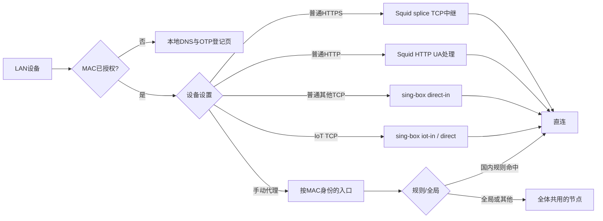

# 实现方式

## 一条请求怎么走

直连表示最终连接目标源站；其中仍有本机 TCP 终结与重新建连。它与把终端的 TCP 报文直接做 NAT 转发不同。默认不对所有设备自动启用境外代理。

## 授权边界

`/etc/config/privacy_access` 是唯一设备权限来源。设备名称、DHCP 地址、备注和人员分组不是授权依据。`privacy-classify.sh` 把 UCI 投影为 nft sets：allowed_macs、normal_macs、iot_macs、temporary_proxy_macs，在单次 nft transaction 中替换。

最早的 prerouting gate 在 NAT 前拦截未授权设备，只放行登记所需的 DHCP、本地门户/DNS路径；explicit proxy 端口另有入口限制，不能直接连接1080/3130/7896等端口绕过。input 与 forward 继续做撤权保护，防止已建立连接在删除授权后长期存活。

普通、IoT 与手动代理的 UDP/IPv6 策略不同；目前 IPv6 外网和 QUIC 禁止，DNS/NTP由路由器接管。IoT/手动代理组仅保留既有DNS/NTP例外，不能把此方案当作完整UDP代理。域内通信和路由器管理与外网访问分开处理。

## 为什么不需要证书

Squid 使用第一阶段 `ssl_bump splice all`，不 peek/bump，不生成网站证书。客户端与源站的 TLS 握手、网站证书和内容保持端到端。监听参数中的 `ssl-bump` 是 Squid 接入语法；最终是否解密由动作决定，不能仅凭这个词判定MITM。

因此路由器可以重新建立 TCP，但不能统一加密的 HTTPS UA、JA3/JA4、HTTP/2应用特征。普通HTTP的UA仍会改写。既有旧代码对MITM模式保留兼容分支，安装器始终写入 `tls-passthrough-v1` 标记。

## 端口与服务

| 端口 | 服务与用途 |
| --- | --- |
| 53 / 5353 / 5354 | 已授权DNS、上游DoH入口、未授权门户DNS |
| 8085 | 设备自助登记 |
| 3129 / 3130 | 普通设备HTTP / HTTPS透传 |
| 3132 / 3131 | 手动代理HTTP / HTTPS透传 |
| 7894 / 7895 / 7897 | 手动非网页TCP、IoT TCP、普通非网页TCP |
| 127.0.0.1:7896 | Squid到sing-box的带认证父代理 |
| 127.0.0.1:9091 | 带secret的本地管理API |
| 1080 | UA3F透明TCP处理 |

这些端口受本地防火墙限制。不要把监听或管理API开放到WAN。用户、节点密码和API secret不写进命令行日志或HTTP页面的诊断输出。

## 手动分流与共享节点

`proxy-policy.lua` 生成sing-box和Squid配置。每台手动设备有独立身份，Squid依据原始LAN MAC选择相应loopback认证父代理。sing-box将同为规则/全局的身份聚合，避免每台设备复制成百上千条规则。

所有手动设备使用同一个 `privacy-select`，最后一次节点选择同步到旧设备；时长与规则/全局仍各自独立。0期限表示长期，其他期限写入持久文件后投影为内核timeout set。规则模式先处理国内域名与IP；境外域名使用受保护DNS解析，防止把污染IP当作正确出口。

IoT当前固定direct，不参与手动代理selector。旧香港自动组仅为历史模式兼容。

## 离线配置导入

`proxy-subscription.lua` 读取URI、Base64、Clash YAML及受支持的原生JSON字段。只允许节点字段，丢弃任意监听、TUN、文件路径、系统命令和外部执行项。`proxy-rules.lua` 转换允许的规则；本地导入不下载外部provider。

流程为：root私有临时文件 → 预览 → 原生sing-box检查 → 内容SHA绑定 → 原子保存/服务重载。哈希变化、无效节点、过大文件或核心启动失败不会悄悄覆盖工作配置。源文件的 `skip-cert-verify` 会保留并在预览/节点列表提示；网站TLS验证仍由终端进行，本项目不额外关闭它。

## OTP登记

CGI从实际邻居表取源MAC，校验LAN路径与Host/Origin，发给页面的令牌绑定MAC、IP及时间窗口。TOTP为SHA-1、30秒、6位，支持相邻窗口时间误差。全局已用step防止一个动态码注册多台设备；失败计数有单MAC和全局限流。

输入验证码成功后调用同一授权CLI，只授予普通组。TOTP及授权更新分别使用文件锁；写入失败会恢复已用step，避免吞码但未授权。随机MAC允许登记，不会按设备名称自动合并旧记录。

## 代码位置

| 文件/目录 | 职责 |
| --- | --- |
| `rootfiles/usr/share/privacy-access/common.sh` | UCI、MAC、set投影与共用逻辑 |
| `discovery.sh` / `people.lua` | 在线发现、备注/名称、人员分组 |
| `registration.sh` / `www/cgi-bin/privacy-register` | TOTP、CSRF、登记授权 |
| `proxy.lua` / `proxy-policy.lua` | 管理事务、节点与规则生成、回滚 |
| `www/luci-static/resources/` | 两个管理页面与共享设备列表组件 |
| `rootfiles/etc/privacy-policy.nft` | 接入/分流/撤权规则 |
| `privacy-latency-monitor` / `monitor-row.lua` | 有时限的三路径网络探针 |
| `install.sh` / `scripts/` | 依赖预检查、初始化、源码验证、安装回滚 |

## 上游校园认证

生产环境保留了其已有认证与掉线恢复服务。本仓库没有打包私人校园认证配置，也没有声称不同学校可以使用同一登录请求。部署前应让路由器本机完成合法上游认证；认证状态机的参数化设计与验证方法可以参阅致谢中的参考项目。本项目不通过页面测速失败就自动重登账号或重启WAN。
